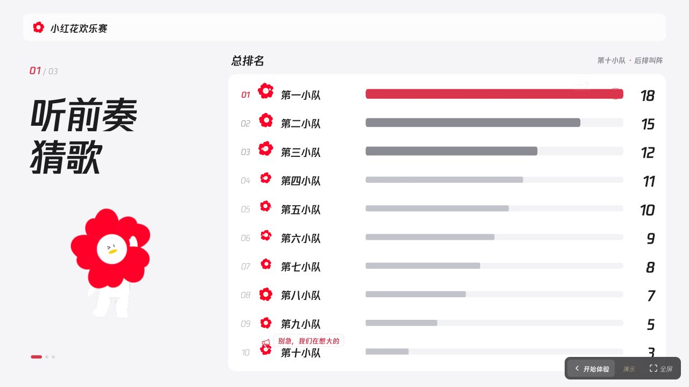

# 小红花团建游戏面板

> **腾讯公益相关 Logo、IP、小红花贴纸和其他品牌素材不得滥用或擅自商用。未经相关权利人明确授权，违规使用可能产生法务及侵权风险，相关后果由使用者自行承担。公开仓库、下载或 Fork 均不构成商用授权。**
>
> 请先阅读完整的 [素材与 IP 使用声明](ASSET_USAGE.md)。第三方软件的开源许可证不覆盖这些品牌素材。本项目的公开展示不代表腾讯或腾讯公益对本项目作出授权、背书或商业许可。

一个用于团建现场的浏览器计分面板：控制台操作，大屏展示当前游戏、团队总排名、分数变化及小红花互动。

- [在线体验后台](https://w88856678-rgb.github.io/red-flower-offsite-panel/?demo=1)
- [在线体验大屏](https://w88856678-rgb.github.io/red-flower-offsite-panel/screen/?demo=1)
- [网页素材声明](https://w88856678-rgb.github.io/red-flower-offsite-panel/materials-notice.html)



## 功能

- 三个游戏：猜歌、逛三园、歌词接龙。主持人口头出题，面板聚焦游戏环境和积分。
- 团队加减分、自定义计分、改队名、撤销、动态柱形排名和前三名放大。
- 得瑟“还有谁！”、榜一全场出击、后排叫阵“别急，我们在憋大的”。互动只影响画面，不修改积分。
- Excel / CSV / TSV / TXT 名单导入、个人独立计分与 MVP 前三。
- 分游戏统计、CSV 导出、JSON 备份和恢复，以及按第三、第二、第一名揭晓的颁奖画面。

## 本地启动

使用 Node.js 24 和 npm：

```sh
npm ci
npm test
npm run build
npm start
```

控制台默认地址：`http://127.0.0.1:4173/?demo=1`。大屏地址：`http://127.0.0.1:4173/screen/?demo=1`。

开发时运行 `npm run dev`。本机使用默认根路径构建；GitHub Pages 工作流自动设置仓库子路径。

## GitHub Pages

在仓库 **Settings → Pages → Build and deployment** 选择 **GitHub Actions**。

`.github/workflows/pages.yml` 会在推送到 `main` 后安装依赖、运行测试、构建并发布 `dist`；也支持手动运行。`scripts/prepare-static.mjs` 为大屏生成独立静态入口，因此直接打开或刷新 `/screen/` 均可使用，不依赖内网穿透。

若部署到自定义子路径，可在构建时设置 `VITE_BASE_PATH`，例如：

```sh
VITE_BASE_PATH=/red-flower-offsite-panel/ npm run build
```

## 数据保存与现场使用

每位访问者的数据保存在自己的浏览器中，未连接远端数据库。不同设备或浏览器不会自动加入同一场比赛；本项目当前不提供跨电脑实时同步。

同一台电脑、同一浏览器中打开同源控制台与大屏，可通过 BroadcastChannel 同步。连接饭店大屏时建议使用系统“扩展显示”，将大屏窗口拖到外接屏并全屏，自己在控制台计分。

演示与正式活动使用独立数据；公开链接默认带 `?demo=1`。使用正式活动时移除该参数，并确保控制台、大屏的模式一致。换地址、换浏览器或换电脑时先导出 JSON 备份再恢复；每个游戏结束后建议备份一次。

仓库不包含真实花名册、现场积分备份、密钥或本机字体。`名单模板.csv` 中仅有虚构样例，请替换后导入。

## 素材与许可证

- 品牌 Logo、IP、小红花贴纸及字体：请遵守 [ASSET_USAGE.md](ASSET_USAGE.md)，**未获授权不得擅自商用**。
- 素材对应关系：[public/stickers/manifest.json](public/stickers/manifest.json)。
- 腾讯体：仅调用本机已合法安装的字体，不随仓库提供字体文件。
- 第三方软件：[第三方许可.txt](第三方许可.txt)，仅适用于对应的软件组件，不适用于品牌素材。
